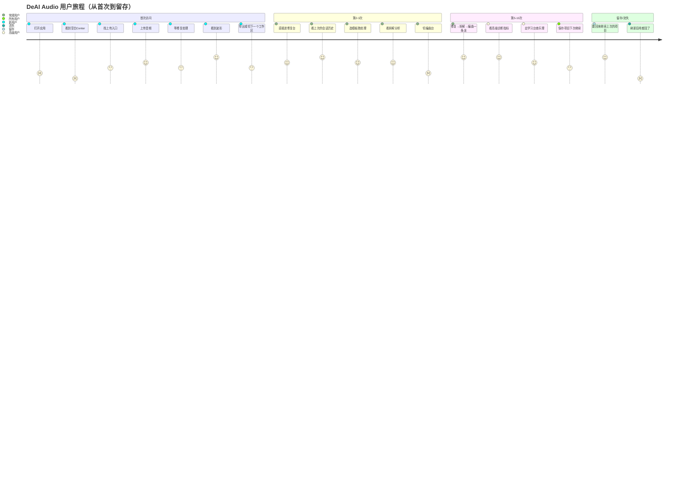

# DeAI Audio —— 产品规划 v1.0（边界冻结）

> 生成日期：2026-10-19  
> 依据：PRODUCT-FRAMEWORK.md v1.0 · 维度一（产品规划）  
> 约束：**本文档冻结 MVP 边界，后续开发必须严格对齐，任何偏离必须显式走变更流程**

---

## §1 一句话产品声明

> **创作者用 DeAI Audio 来修复、拆解、编曲、写词、学习——一站式把一段原始音频变成完整的音乐工程。**

拆解：
- 用户类型：创作者（独立音乐人、混音师、音乐爱好者）
- 完成目标：从"一段原始素材"到"一个可编辑、可导出的完整音乐工程"
- 5个工作区的顺序是**线性流水线**：修复 → 拆解 → 编曲 → 写词 → 学习

---

## §2 三种典型用户场景（含成功标志）

### 场景 A：新用户（第1次进来，不知道能干嘛）
- **动作**：打开应用 → 看到空白的Center → 不知道该点哪
- **情绪**：好奇（"这玩意儿能干嘛？"）→ 困惑（"从哪开始？"）
- **用户的期望**：有一个明确的引导，告诉我第一步该做什么
- **成功标志**："我跟着引导上传了一段音频，看到它被修复了，还看到了拆解分析结果"
- **Gap**：当前**没有首次进入的欢迎引导Modal**，Center是空白占位

### 场景 B：常规用户（已经用了3次，有明确的修复→拆解→编曲流程）
- **动作**：上传音频 → 选修复模板 → 等处理 → 看波形 → 导出 / 切到拆解台看分析 → 用拆解结果去编曲台
- **情绪**：满意（"修复效果不错"）→ 期待（"拆解出的和弦准不准？"）→ 流畅（"可以开始编曲了"）
- **用户的期望**：修复→拆解→编曲之间有明确的数据传递，不用手动复制粘贴
- **成功标志**："我上传了一段干声，修复完直接点'去拆解台'，拆解完的和弦自动出现在编曲台的时间线里"
- **Gap**：当前**工作区之间没有数据自动传递**，拆解结果存了但编曲台没自动渲染

### 场景 C：高级用户（追求效率，想知道为什么）
- **动作**：修复完 → 看诊断面板的相位熵/瞬态缺失 → 拆解完 → 看K-S调性检测的置信度 → 学习台 → 点"相位熵"关联乐理笔记
- **情绪**：精准（"诊断数据对得上"）→ 好奇（"为什么相位熵高了会有问题？"）→ 满足（"原来如此"）
- **用户的期望**：每个诊断指标都能点开看解释，学习台有对应的乐理卡
- **成功标志**："我看到了相位熵 > 0.9 的警告，点一下就能看到解释和修复建议"
- **Gap**：当前诊断面板只显示数字，**没有可点击的学习入口**

---

## §3 用户旅程图（Mermaid）



### 旅程中的满足度矩阵

| 节点 | 用户在做什么 | 情绪 | 期望 | 当前满足度 | 改进方向 |
|---|---|---|---|---|---|
| 首次打开 | 看空白Center | 困惑 | 有引导 | ❌ | 欢迎引导Modal + 空状态设计 |
| 上传音频 | 拖入或点击 | 好奇 | 有反馈 | ⚠️ | 上传进度条 + 立即反馈 |
| 修复处理中 | 等后端 | 焦虑 | 进度反馈 | ⚠️ | 后端SSE进度流 + 进度条 |
| 修复完成 | 看波形 | 满意 | 下一步引导 | ❌ | "接下来可以→去拆解台" |
| 拆解完成 | 看分析报告 | 期待 | 数据传递 | ❌ | 自动注入编曲台Timeline |
| 编曲中 | 拖Clip | 流畅 | 稳定 | ✅ | — |
| 刷新后 | 找项目 | 焦虑 | 自动保存 | ❌ | IndexedDB自动保存 |
| 学习台 | 看乐理卡 | 满足 | 关联操作 | ⚠️ | 从诊断指标可点击跳转 |

---

## §4 功能优先级矩阵（冻结MVP边界）

### 第一象限：高频必需（MVP 必须做，当前已有/即将实现）

| 功能 | 对应工作区 | 后端状态 | 前端状态 | 优先级 |
|---|---|---|---|---|
| 音频上传 + 格式校验 | repair | ✅ /process已实现 | ✅ DropZone已实现 | P0 |
| 修复Pipeline（DC→declip→deverb→sep→denoise→pitch→transient→norm→export） | repair | ✅ 完整链已跑通 | ✅ RepairWorkspace + WaveformPlayer | P0 |
| 多模板切换 | repair | ✅ /templates已实现 | ✅ TemplateSelector | P0 |
| 波形对比（原始vs处理后） | repair | ✅ /waveform已实现 | ✅ WaveSurfer双轨道 | P0 |
| 分段卡片 + 场景标签 | repair | ✅ Pipeline已产出segments | ✅ SegmentList | P0 |
| 导出WAV/M4A/MP3 | repair | ✅ /export已实现 | ✅ ExportBar | P0 |
| 参考拆解（BPM/Key/和弦/结构） | reference | ✅ /analyze已实现 | ✅ AnalysisReportView | P0 |
| 编曲台Timeline | compose | 🔶 generateMidi占位 | ✅ TimelineView | P1 |
| 轨道管理（加/删/改/音量） | compose | — | ✅ TrackList | P1 |
| Clip方块渲染 + 移动 | compose | — | ✅ TimelineView已实现 | P1 |
| 歌词段落管理 | lyric | — | ✅ LyricLeftPanel | P1 |
| 歌词编辑器 + 音节吸附 | lyric | 🔶 countSyllables占位 | ✅ LyricEditor（简化版） | P1 |
| 乐理卡片学习 | learn | 🔶 getTheoryCards占位 | ✅ KnowledgeCardGrid内置5张 | P2 |
| 5工作区导航切换 | 全局 | — | ✅ BottomBar Tab + Desktop Side Panel | P0 |
| 响应式布局（三档断点） | 全局 | — | ✅ useResponsive + 抽屉式面板 | P0 |
| 后端健康检测 | 全局 | ✅ /health | ✅ TopBar绿点 | P0 |

### 第二象限：低频必需（MVP要做，但可以做浅）

| 功能 | 当前深度 | MVP要求深度 |
|---|---|---|
| 会话历史（多项目管理） | 单个sessionStore | 至少支持3个历史项目，localStorage持久化 |
| 撤销/重做 | 无 | 修复台/编曲台核心操作至少支持撤销 |
| 播放头Transport | transportStore已实现 | TimelineView里的播放头RAF驱动 |
| 和弦建议 | suggestChords占位 | 先做mock数据返回，后端后补 |
| 歌词续写 | continueLyrics占位 | 先做mock返回，后端后补 |
| AI对话 | chat占位 | 先做UI壳，流式响应mock |
| 学习卡用户生成 | 无 | 手动创建卡 + 标签分类 |
| 项目导出（工程文件） | 无 | 先导出JSON，导入后可恢复 |

### 第三象限：高频可选（第二阶段，显式推迟）

| 功能 | 推迟理由 |
|---|---|
| 实时协作编辑 | 需要后端WebSocket + 冲突解决，复杂度高 |
| 模板市场（云端） | 需要用户系统 + 审核流程，MVP不做 |
| 一键风格化（上传参考→自动应用） | Recipe已经有数据结构，但applyRecipe后端占位 |
| MIDI键盘输入 | 需要Web MIDI API + 延迟优化 |
| VST/AU插件集成 | Electron可行但跨平台测试成本高 |

### 第四象限：低频可选（写下来然后忘它）

| 功能 | 推迟理由 |
|---|---|
| 多人远程协作 | 需要全栈重构 |
| 云端同步项目 | 需要用户系统 + 存储成本 |
| iOS/Android原生App | 先用Web/Electron验证 |
| 社区/评分系统 | 完全独立模块 |
| API开放给第三方 | 先把产品跑通再开放 |

**铁律**：第三、第四象限的功能**禁止进入当前迭代**。如果想做，必须先升级到v2.0规划。

---

## §5 核心操作闭环路径（每个核心操作的完整路径）

### 闭环1：修复音频（MVP核心）
```
入口：用户拖入或点击上传音频文件
  ↓
处理：前端校验格式 → 创建会话 → POST /process → 后端跑完整Pipeline
  ↓
反馈：
  Loading：Center显示Spinner + 进度文本（"解码音频…" → "分离人声…" → "归一化…"）
  Success：波形出现 → 分段卡片出现 → Toast "修复完成 ✓" → ExportBar激活
  Error：Toast红色错误 → Center显示"修复失败 + 错误信息 + 重试按钮"
  ↓
下一步路径（RightPanel自动弹出引导卡）：
  [→ 去拆解台看和弦分析]   ← 高频推荐
  [→ 导出音频]             ← 次选
  [→ 继续修复另一段]        ← 兜底
```

### 闭环2：参考拆解（MVP核心）
```
入口：用户在拆解台拖入参考音频
  ↓
处理：POST /analyze → Librosa跑beat tracking / K-S key detect / SSM segmentation / chroma chords
  ↓
反馈：
  Loading：Center显示Disc图标 + animate-pulse + 进度文本
  Success：AnalysisReportView渲染（BPM/Key/Structure/Chords/ProductionNotes）+ Toast "拆解完成 ✓"
  Error：Center显示Upload图标 + 红色错误文本
  ↓
下一步路径（拆解报告底部自动出现）：
  [→ 一键把和弦注入编曲台]  ← 高频推荐
  [→ 生成配方（Recipe）]    ← 次选
  [→ 查看乐理笔记]          ← 兜底
```

### 闭环3：编曲（MVP核心）
```
入口：从拆解台注入和弦 / 手动加轨道 / 加Clip
  ↓
处理：更新projectStore → TimelineView重渲染
  ↓
反馈：
  Loading：Clip方块显示占位，更新后显示完整
  Success：Clip出现在时间线 + RightPanel显示和弦建议
  Error：Toast错误 + 不保存Clip
  ↓
下一步路径（RightPanel自动出现）：
  [→ 去词作台写歌词]       ← 高频推荐
  [→ 继续加轨道]            ← 次选
  [→ 导出工程JSON]          ← 兜底
```

### 闭环4：写词（MVP核心）
```
入口：在词作台加Verse/Chorus段落
  ↓
处理：文本输入 → 音节自动拆分（updateLyricLine里已实现）
  ↓
反馈：
  Loading：字符数实时更新
  Success：音节自动吸附 + 字数统计更新
  Error：Toast红色提示
  ↓
下一步路径（RightPanel自动出现）：
  [→ 用AI续写（mock）]      ← 次选
  [→ 查看押韵建议（mock）]  ← 兜底
```

### 闭环5：学习（MVP核心）
```
入口：点击内置乐理卡 / 从诊断面板点击"相位熵"跳转
  ↓
处理：KnowledgeCardGrid渲染details/summary
  ↓
反馈：
  Loading：首次注入内置卡（useEffect + knowledge.length===0）
  Success：卡片展开显示deep_explanation + 关联操作标签
  Error：无（本地数据）
  ↓
下一步路径（卡片底部）：
  [→ 标记为已学]            ← 主操作
  [→ 创建新卡]              ← 次选
```

---

## §6 边界冻结 Checklist（框架1.3要求）

- [x] 有明确的用户目标声明（≤ 2 句话） → §1 已完成
- [x] 有 ≥ 3 种典型用户场景的旅程描述 → §2 已完成（新/常/高）
- [x] MVP 边界文档列出「故意推迟的功能」≥ 5 项 → §4 第三象限 5 项 + 第四象限 5 项
- [x] 核心操作路径长度 ≤ 5 步（从入口到完成） → §5 每个闭环都是3-5步
- [ ] 空状态有设计方案 → 将在阶段2实现（repair没上传/reference没拆解/compose没轨道/lyric没段落）
- [ ] 错误状态有处理方案 → 将在阶段2实现（网络断开/上传失败/处理失败）
- [ ] 用户完成核心操作后有明确的"下一步引导" → 将在阶段2实现（每个闭环的最后一步）
- [x] 主要用户旅程已用可视化图呈现 → §3 Mermaid journey图

**6/8 已完成，剩余2项进入阶段2实现阶段**

---

## §7 变更流程

任何对本文档的修改必须：
1. 标注变更日期和变更人
2. 在§8记录变更日志
3. 不得删除已列入"推迟清单"的功能——只能在v2.0规划里重新评估
4. 变更后重新跑§6 Checklist

## §8 变更日志

| 日期 | 版本 | 变更 | 变更人 |
|---|---|---|---|
| 2026-10-19 | v1.0 | 初始版本，冻结MVP边界 | Agent |
